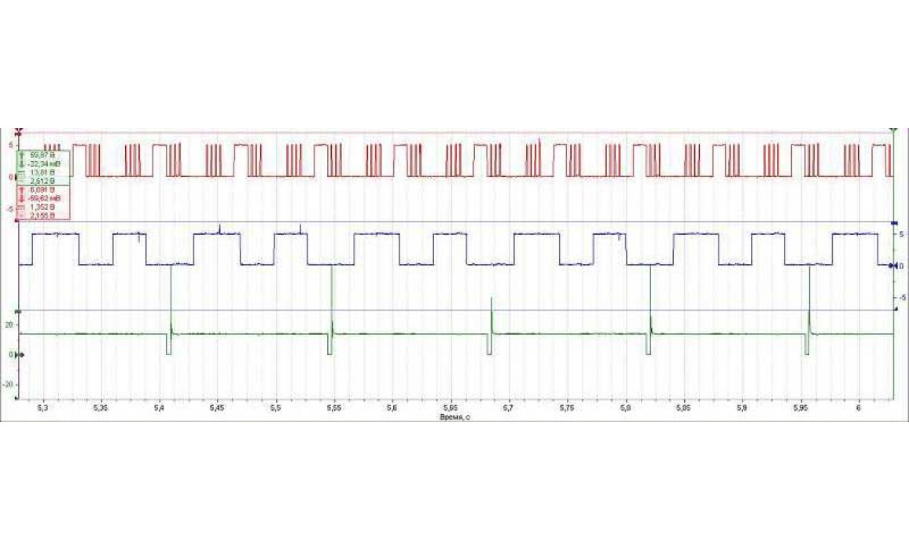
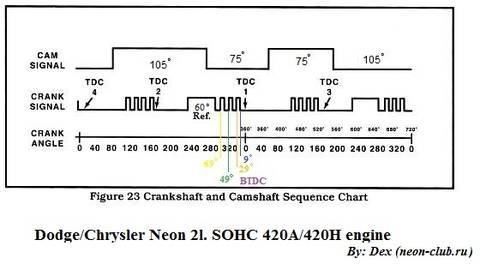

# Engine control algorithms

This page explains what the firmware computes and which calibration tables are involved. Routine
names refer to the source; table names to the [calibration reference](calibration_tables.md).
Parts marked *(from names)* follow the names in the original disassembly and still need to be
checked against the code.

## Engine position and event scheduling

*Roles inferred from the code; to be confirmed with a scope on a running engine.*

- **Crank sensor -> TIC1 (PA2)** (`Isr_TIC1_CrankEvent`). Every edge is time-stamped. Together with
  input capture 3 on the other edge (PA0) the firmware measures the slot width and the period, which
  identifies the reference slots. Once synchronised, each edge increments `CrankEventCounter`
  ($0449) and calls one of four handlers (`CrankPickupIntrAddressTable`), chosen by the event phase:
  `CrankInterrupt_FallingEdge`, `..._HandleCamSensorRisingEdgeA/B` and `CrankInterrupt_CalculateFuel`.
- **Cam sensor -> PAI (PA7)** (`Isr_PAI_CamPhase`). Both edges are caught by flipping the PAI edge
  select. The level of the crank signal at that moment tells which half of the 720 degree cycle it is,
  and sets the phase in `CrankEventCounter` and the sync flags (`SyncFlags74`, `SyncFlags75`).
- **Ignition:** two coils in wasted-spark mode, driven straight from **OC3 (PA5)** and **OC5 (PA3)**.
  `ScheduleIgnitionCoils` writes the compare times and the TCTL1 pin actions (dwell start, then fire);
  `Interrupt_DwellTimerA/B` chain the next action.
- **Injectors:** sequential, but **not** timed by the HC11. `IncludeInjectorLatency` writes the final
  pulse width (microseconds, latency included) into the external I/O device: `$0424` cylinder 1,
  `$0428` cylinder 2, `$042C` cylinder 3, `$0430` cylinder 4. `InjCylinderMask` selects the
  cylinders (bit 0 = cyl 4, bit 1 = cyl 2, bit 2 = cyl 1, bit 3 = cyl 3, firing order 1-3-4-2), and
  writing `$04` to `$0410` hands the pulse over to the device.
- **The four crank event handlers** run in a fixed sequence (event phase = low two bits of `SyncFlags75`):

  | Phase | Handler | Main jobs |
  |---|---|---|
  | 0 | `CrankInterrupt_FallingEdge` | period and slot-width bookkeeping, rev limiter, MAP plausibility checks, idle spark scatter, injector hand-off |
  | 1 | `CrankInterrupt_HandleCamSensorRisingEdgeA` | injector scheduling for the next cylinders |
  | 2 | `CrankInterrupt_HandleCamSensorRisingEdgeB` | injector scheduling, adaptive retard index, running-time counters |
  | 3 | `CrankInterrupt_CalculateFuel` | RPM, MAP sampling, knock window, coil forcing, running fuel, per-cylinder knock retard |

  (The "CamSensorRisingEdge" names are historical; all four run from the crank interrupt.)
- **MAP** is sampled at a fixed crank angle: phase 3 starts an A/D scan of channels 0-3 (`ADCTL = $10`).
- **Knock window:** phase 3 sets `TOC4 = edge time + 2 x tooth time x factor / 256`, a fixed fraction of
  the tooth period after the edge, and `Isr_TOC4_KnockSample` reads the knock sensor when it expires.
- **Sensor signals** (scope captures at idle, about 880 rpm; one from the project owner's car, one
  published reference capture):

  
  *Owner's car at idle: CH1 crank, CH2 cam, 10 ms/div.*

  
  *Published reference capture: red crank, blue cam, green ignition/injector reference.*

  
  *Chrysler sequence chart for the 2.0 SOHC (420A/420H), annotated by Dex (neon-club.ru).*

  - **Crank:** one group of four pulses every 180 degrees of crankshaft (one group per cylinder
    event, about 34 ms apart at idle). Inside a group the rising edges are about 3.8 ms apart, which
    is roughly 20 degrees. In every second group the first pulse is wide (it starts about 60 degrees
    earlier), which marks the two halves of a revolution.
  - **Cam:** windows of two different lengths, roughly 0.83 and 1.17 times the group spacing,
    arranged long - short - short - long over 720 degrees, so four cam edges per cycle.
  - **Match with the code:** IC1 sees the four rising edges of each group, which are the four event
    phases, so the four handlers are the four slots of one cylinder event. The long low time before
    the first rising edge of a group is what the slot-width check in `Isr_TIC1_CrankEvent` detects.
    Doing the MAP sample and the knock window in phase 3 (the last slot, closest to TDC) fits this
    picture. `Isr_PAI_CamPhase` reads the crank level at each cam edge: some cam edges fall inside a
    wide crank pulse (level high), others in a gap (level low), which identifies the cylinder.
  - **Angles** (Chrysler service manual, "Crankshaft and Camshaft Sequence Chart", 2.0 SOHC 420A/420H):
    the four slots of each group are at **69, 49, 29 and 9 degrees BTDC**; the wide 60 degree
    reference window comes before the groups of cylinders 1 and 4 (every 360 degrees); the cam windows
    are 105 / 75 / 75 / 105 cam degrees (210 / 150 / 150 / 210 crank degrees). The firing order is
    1-3-4-2. All of this agrees with the scope measurements above.
  - With phase 0 = first slot of the group (the edge after the long gap), the phases are
    **0 = 69, 1 = 49, 2 = 29, 3 = 9 degrees BTDC**. Phase 3, where MAP is sampled and the knock window
    is armed, is the 9 degree BTDC slot.
  - **Verification needed:** the signal polarity at the HC11 pins. The input buffer may invert the
    sensor signal, which would make IC1 see the other edge of each slot and shift the phase angles by
    the slot width. Checking it means probing the CPU pins, which requires opening the controller
    (the board is potted in soft compound), so it has not been done yet.

## Input coordinates

Most maps are 3D tables whose axes are 0-255 coordinates produced by transfer curves:

| Curve | Input -> output | Used by |
|---|---|---|
| `RPMSCL` | engine RPM -> column coordinate (`RPMRescaledfor3D`) | all RPM x MAP maps |
| `MAPHI` | MAP -> row coordinate (`MAPRescaledfor3D`) | PRTTBL, HOTMRP, WOTMRP |
| `MAPWOT` | MAP -> row coordinate for WOT enrichment | WOTENR |
| `MAPPTE` | MAP -> row coordinate for part-throttle enrichment | PTEADJ |
| `MAPHIP`, `MAPHII` | MAP -> row coordinate, off idle / idle | CLDLDP, CLDLDI |
| `MAPMOD` | MAP -> coordinate for the cold/base advance map | BASADV |
| `TIMESC` | time since start -> coordinate | CURV3D |

The breakpoints of a map are therefore set by its transfer curve. In 5007033, for example, Mopar
changed the low end of `RPMSCL`, which moves the first columns of every RPM x MAP map.

## Fuel

### Where it is computed

| When | Routine | Result |
|---|---|---|
| Main loop, every 10.75 ms | `CalculateSumOfAllFuelModifiers_MM` | `SumOfFuelModifiers`: cold, after-start, baro, charge-air and closed-loop factors |
| Main loop | `CalculatePartThrottleEnrichmentAndLatency_MM` | `ThrottleEnrichmentFactor` (part throttle / WOT) and `InjectorLatencyPW` |
| Main loop | `CalculatePartThrottleTransientFuel` | additive pump-shot pulse, decel lean-out factors, AIS step enrichment |
| Main loop | `CalculateInjectorPulsewidthForStarting_MM` | cranking pulse width and the start-to-run decay rate |
| Main loop | `HandleO2Processing_MM` | O2 controller and adaptive memory |
| Crank event, phase 3 (9 deg BTDC) | `CrankInterrupt_CalculateFuel` -> `CalculateInjectorPulsewidthForEngineRunning` -> `HandleTransitionFromStartToRun` -> `IncludeInjectorLatency` | final pulse width, written to the injector registers of the I/O device |

So the slow factors are refreshed every 10.75 ms, while the final pulse width uses the MAP value
sampled at the same crank angle and is computed once per cylinder event.

### Running

```
air      = (MAP - MAPMIN) x DFPART / 2
base_pw  = air + air x PRTTBL(rpm, map) / 256
pw       = base_pw x throttle_enrichment x SumOfFuelModifiers  (+ knock enrichment)
         + pump-shot pulse
pw       = max(pw, decaying start pulse)        while the start flag is set
pw_total = pw x fuel-pressure factor + InjectorLatencyPW x 4      (microseconds)
```

- `PRTTBL` is the main fuel map: a correction over the MAP-proportional base, similar to a
  volumetric-efficiency table.
- **Throttle enrichment** (`CalculatePartThrottleEnrichmentAndLatency_MM`): part-throttle map
  `PTEADJ` (RPM x `MAPPTE`) or WOT map `WOTENR` (RPM x `MAPWOT`), selected with the `RPMMAP` switch
  point. The factor moves towards its target in steps (`PTENRP`, `PTENRN`, `PTENRD`), so enrichment
  ramps in and out instead of jumping.
- **`SumOfFuelModifiers`** (`CalculateSumOfAllFuelModifiers_MM`) is the product of:
  - cold-engine enrichment `CLDLDP` / `CLDLDI` (coolant x load, off idle / idle);
  - after-start enrichment `CURV3D` (coolant x time since start), with a heat-soak correction after a
    short stall (`RUNTMP`, `RUNLMT`);
  - barometric compensation `BAROCP` and enrichment `BARENR x BARMAP x BARRPM`;
  - charge-air temperature enrichment `AIRTMP x AIRMAP x AIRRPM`;
  - the O2 closed-loop and adaptive memory factor.
- `KNNRCH` / `MAXKNR` add fuel in proportion to the total knock retard.
- `TweakInjectorPW` lets the diagnostic link override the pulse width (enabled by calibration byte
  `$D03E`); it is inactive in normal operation.

### Cranking (`CalculateInjectorPulsewidthForStarting_MM`)

```
start_pw = [STRTFL^2 x (1 - STFBAR - STFTMP) x EPPMUL + BATOFF x 4] x 4 us
```

`STRTFL` vs coolant temperature (not colder than `STRLMT`), reduced for altitude (`STFBAR`) and as
the engine warms (`STFTMP`, `STFTM2`). `EPPMUL` tapers the fuel with the number of engine position
pulses since cranking began, and `STFLID` / `STFLOI` scale it with RPM for closed / open throttle.
Opening the throttle more than `UNLOAD` above the learned minimum cuts cranking fuel ("clear flood").
After start, `HandleTransitionFromStartToRun` keeps the larger of the running pulse and the start
pulse decaying at the `SFDCAY` rate, then switches to running fuel only.

### Transient fuel (`CalculatePartThrottleTransientFuel`)

- **Tip-in:** MAP and TPS are compared with filtered averages (time constants `AETIME`, `THRTCN`
  vs coolant). A rise above `MAPTRG` / `POSTRG`, limited by `MAPMAX` / `THRMAX`, gives an additive
  pulse of `delta x AESLOP` or `delta x POSSLP` (vs coolant).
- **Tip-out:** a fall gives lean-out factors (`LOTTHR`, `NEGSL2`, triggers `LOTTRG`, `LOTRG2`,
  `DECTRG` with hysteresis, time constants `LMAPTC`, `LOTIME`, minimum RPM `LOTRPM`) and holds the O2
  controller for `DCELTM` afterwards.
- **AIS steps:** opening or closing the idle air motor adds a small enrichment or enleanment pulse
  (`AISPL1`, `AISPL2`, `AISNLC`), so the idle mixture follows the air change.
- **Deceleration fuel cut-off** (`DecideToUseDecelFuelCut`): closed throttle, RPM between `DCLRPL`
  and `DCLRPH` relative to the target idle speed, coolant above `DCLMCT`, running time above `DCLMER`.

### Closed loop and adaptive memory (`HandleO2Processing_MM`)

- Narrow-band O2. The controller kicks the mixture rich or lean in steps until the sensor toggles.
  The kick sizes come from `PRIRMP` (primary ramp) and `SECRMP` (secondary ramp), per **ramp cell**:
  3 RPM bands x 3 MAP bands (`DetermineRampCellFromRPMandMAP`), plus an idle cell.
- The secondary ramp also teaches the **adaptive memory** (`AdaptiveMemory_*`): **cells 0-11** =
  six MAP bands (`MP1`..`MP5`, hysteresis `DLTMAP`) x two RPM bands (`R1`, hysteresis `DLTRPM`), plus
  **idle cells 12 and 13** for closed throttle below target idle + `IDLOFS` (cell 13 when a second
  idle load state is active). The cells are in RAM `AutoCalCell0`..`AutoCalCellEnd` and survive warm
  restarts.
- `MAPLIM`, `MAPDEC`, `RPMLIM`, `PWMIN` define where cells are not updated (open loop at high load);
  `O2LIMH`/`O2LIML` and `AMLIMH`/`AMLIML` limit the correction.

## Spark (`CalculateSparkAdvance_MM`, main loop)

`BitFlags65` bit 7 (throttle open, the same flag that selects the idle O2 cell) chooses the path.

**Off idle** (`LookupNormalAdvance`):

```
correction = BASADV(coolant, MAPMOD) + BASMAP x BASRPM + BASMAP x BASCHG     (charge-air)
main       = WOTMRP(rpm, MAPWOT)                         at wide open throttle (BitFlags65 bit 0)
           = HOTMRP(rpm, MAPHI) + ADOTFN(off-throttle timer)    at part throttle
advance    = main + correction + ADVNGM(vacuum vs baro)
           - adaptive retard (ARRPM + ARMAP) x AdaptiveRetardIndex
           - TPS retard (TPSRT1 / TPSRT2) - speed retard (RETSPD) - delta-RPM retard
           limited by MaxAdvanceLookup and by the minimum-advance clamp
```

`MaxAdvanceLookup` is the WOT map value; at part throttle with MAP at or above the `RPMMAP` switch
point it is lowered to the part-throttle value. Every step saturates to a signed byte.

**Idle** (`CalculateIdleAdvance`): `HOTMRP` + charge-air / MAP correction `IDLIAT x ILDMAP` + coolant
corrections `IDLADV` / `IDLAD2` + a closed-loop trim from the O2 feedback counter (`ADO2C1`,
`ADO2C2`, limits `ADO2CL`, `ADO2CH`).

**Idle spark scatter** (`HandleSparkScatter`, in the crank interrupt): idle speed is held mainly by
small, fast spark changes (`SPKADD`/`SPKAD2` when RPM is below target, `SPKRET`/`SPKRT2` above,
vs the RPM error); the AIS motor makes the slower corrections.

**Knock:**
- The sensor is sampled at the end of the window timed by OC4 (`Isr_TOC4_KnockSample`).
- `CalculateKnockRetard_MM` (main loop) declares knock when the sample exceeds the background average
  (`CalculateAverageKnockVolts_SM`) by `DLTKNK` (vs RPM), above `KNKMAP` and `KNKRPM`; total retard
  is limited by `RETMAX` (vs MAP).
- The per-cylinder retard is updated in the crank interrupt
  (`CALC_SPARK_RETARD_BASED_ON_KNOCK_VOLT`): rate `RTRDRT`, recovery `INCSRT`, limit `MAXRTD` (vs MAP).
- The long-term **adaptive retard** (`ARMAP`, `ARRPM`) is learned from repeated knock; `ARMPIC = $FF`
  disables it. The total knock retard also enriches the fuel (`KNNRCH`, `MAXKNR`).

Advance values are signed bytes in 0.5 degree steps (`raw / 2` = degrees BTDC).

## Idle (`CalculateTargetIdleSpeed_MM`, `ControlAIS_MM`)

- Target idle speed vs coolant temperature: `AISPN` (park / neutral or manual) and `AISCLD` (drive,
  automatic), plus time- and load-dependent adders (for example the decel curve `TIMED2`).
- AIS steps are compensated in the fuel (see transient fuel) and idle speed is trimmed by spark scatter.

`ControlAIS_MM` keeps the AIS state in the low nibble of `AISSubIndex` and runs one state routine
per pass (`AISSubroutineTable`). While the engine is not running it forces state 0 or 1 by RPM
(`BYTEc581`); a MAP sensor failure forces state 15. In the running states,
`SelectAisStateA`/`SelectAisStateB` choose between throttle open, throttle closed and speed control.

| State | Routine | When | What it does |
|---|---|---|---|
| 0 | `AisState0_EngineStopped` | Key on, engine stopped | Holds `BYTEc580` + `CALPOS` (baro compensated), goes to 1 when RPM reaches `BYTEc581` |
| 1 | `AisState1_Cranking` | Cranking / start | `AISTRT`(coolant) + `CALPOS`, baro compensated; hands over to a running state when the motor is in position |
| 4, 12 | `AisState4_ThrottleOpen`, `AisState12_ThrottleOpen` | Throttle open | Position from speed (`MPHPOS`), RPM (`RPMPOS`), a 3D table, cold (`CLDPOS`) and throttle (`THRPOS`), the largest wins |
| 5, 13 | `AisState5_ClosedThrottle`, `AisState13_ClosedThrottle` | Throttle closed | Closed-loop idle speed control towards the target, A/C compensation, decel fuel cut decision |
| 6, 14 | `AisState6_SpeedControl`, `AisState14_SpeedControl` | Speed control engaged (flag set by the cruise servo routine) | Holds the position for cruise |
| 15 | `AisState15_MapLimpIn` | MAP sensor failure | Fixed position, 32 steps |
| 2, 3, 7-11 | `AisState_Unused` | — | Not used, return to state 0 |

The 12-14 versions also apply the **load-step records** (`AisLoadStepRecords`, eight 10-byte
records at $37DE) through `AdjustAISPosition_A/B`. Each record adds or removes a step from a
calibration byte when its conditions match, and remembers that in `AisLoadFlagsA`. Which state set
is used depends on whether `AisLoadFlagsA` and `AisLoadFlagsB` agree. [code] Which load each record
stands for (A/C, fan, power steering …) is not decoded yet.

## Limiters (`ControlEngineCutout_MM`, `CalculateVariableRevLimit_MM`)

Fuel is cut for whole engine revolutions:

- **Rev limiter:** `REVLMT5` / `REVLMT6` (RPM / 32).
- **Speed limiter:** `SPDLMH` / `SPDLML`.
- **Limp-mode limits** when the MAP or TPS signal is bad (`REVLMT` .. `REVLMT4`).
- **MAP / "overboost" cut-off** (`MPSHFT`, `MPSHFA`, `TRNTIM`), inherited from the turbo code.

## Emissions

- **EGR** (`ExhGasRecirc_MM`): the solenoid is enabled when RPM, MAP (depending on baro), coolant
  temperature and time since start are inside the `EGR21`..`EGR27` windows, and only if
  configuration bit $B811.6 is set.
- **Canister purge**: duty-cycle routine at $B290 (output bit 5 of `OutputDriverBits`) and
  `ControlPurgeSolenoid_MM` ($9C6A, `OutputBits2` bit 7). B4CC never calls `ControlPurgeSolenoid_MM`;
  B559 does (see [code_bases.md](code_bases.md#b559-compared-with-b4cc)).
- **Downstream O2** sensor monitor (`VerifyOperationOfDownstreamO2Sensor_MM`), called only in B559.
- **OBD-II monitors (dormant).** The code contains ten OBD-II monitors (O2 heaters, O2 response,
  secondary air, EVAP purge flow, catalyst, EGR flow, fuel system rich / lean, misfire) with their
  scheduler `ObdMonitorScheduler` ($E9C5), but nothing calls the scheduler in B4CC, so none
  of them runs there (B559 calls it). See [diagnostics.md](diagnostics.md#obd-ii-monitors).

## Other outputs *(from names)*

- **Radiator fan** (`ControlFan_MM`, `FANTMP*`).
- **A/C clutch** (`ControlAirConditioning_MM`), with a WOT cut-out.
- **ASD relay** (`ControlAsdRelay_MM`): fuel pump, injectors and coils power.
- **Alternator field** (`ControlAlternator`): the controller regulates the charging voltage itself.
- **Torque converter lock-up** (`ControlPTU_MM`): automatic transmission only.
- **Cruise control servo** (`ControlCruiseServo0_MM`, `ControlCruiseServo1_MM`).

## Diagnostics and communication

The DRB and ISO 9141 protocols, the actuator tests, the lamps and the OBD-II monitors are described in
[diagnostics.md](diagnostics.md), the fault descriptors in [fault_codes.md](fault_codes.md). The CCD
bus and the I/O companion chip that carries it are described in [ccd_and_link.md](ccd_and_link.md).
