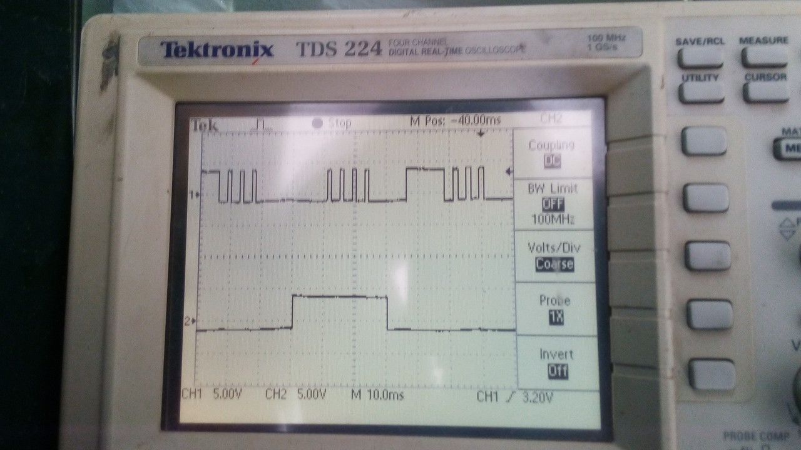

# Engine control algorithms

This page explains what the firmware computes and which calibration tables are involved. Routine
names refer to the source; table names to the [calibration reference](calibration_tables.md).
Parts marked *(from names)* follow the names in the original disassembly and still need to be
checked against the code.

## Engine position and event scheduling

*Roles inferred from the code; to be confirmed with a scope on a running engine.*

- **Crank sensor -> TIC1 (PA2)** (`Isr_TIC1_CrankEvent`). Every edge is time-stamped. Together with
  input capture 3 on the other edge (PA0) the firmware measures the slot width and the period, which
  identifies the reference slots. Once synchronised, each edge increments `CrankEventCounter`
  ($0449) and calls one of four handlers (`CrankPickupIntrAddressTable`), chosen by the event phase:
  `CrankInterrupt_FallingEdge`, `..._HandleCamSensorRisingEdgeA/B` and `CrankInterrupt_CalculateFuel`.
- **Cam sensor -> PAI (PA7)** (`Isr_PAI_CamPhase`). Both edges are caught by flipping the PAI edge
  select. The level of the crank signal at that moment tells which half of the 720 degree cycle it is,
  and sets the phase in `CrankEventCounter` and the sync flags (`SyncFlags74`, `SyncFlags75`).
- **Ignition:** two coils in wasted-spark mode, driven straight from **OC3 (PA5)** and **OC5 (PA3)**.
  `ScheduleIgnitionCoils` writes the compare times and the TCTL1 pin actions (dwell start, then fire);
  `Interrupt_DwellTimerA/B` chain the next action.
- **Injectors:** sequential, but **not** timed by the HC11. `IncludeInjectorLatency` writes the final
  pulse width (microseconds, latency included) into the external I/O device: `$0424` cylinder 1,
  `$0428` cylinder 2, `$042C` cylinder 3, `$0430` cylinder 4. `InjCylinderMask` selects the
  cylinders (bit 0 = cyl 4, bit 1 = cyl 2, bit 2 = cyl 1, bit 3 = cyl 3, firing order 1-3-4-2), and
  writing `$04` to `$0410` hands the pulse over to the device.
- **The four crank event handlers** run in a fixed sequence (event phase = low two bits of `SyncFlags75`):

  | Phase | Handler | Main jobs |
  |---|---|---|
  | 0 | `CrankInterrupt_FallingEdge` | period and slot-width bookkeeping, rev limiter, MAP plausibility checks, idle spark scatter, injector hand-off |
  | 1 | `CrankInterrupt_HandleCamSensorRisingEdgeA` | injector scheduling for the next cylinders |
  | 2 | `CrankInterrupt_HandleCamSensorRisingEdgeB` | injector scheduling, adaptive retard index, running-time counters |
  | 3 | `CrankInterrupt_CalculateFuel` | RPM, MAP sampling, knock window, coil forcing, running fuel, per-cylinder knock retard |

  (The "CamSensorRisingEdge" names are historical; all four run from the crank interrupt.)
- **MAP** is sampled at a fixed crank angle: phase 3 starts an A/D scan of channels 0-3 (`ADCTL = $10`).
- **Knock window:** phase 3 sets `TOC4 = edge time + 2 x tooth time x factor / 256`, a fixed fraction of
  the tooth period after the edge, and `Isr_TOC4_KnockSample` reads the knock sensor when it expires.
- **Sensor signals** (scope captures at idle, about 880 rpm; one from the project owner's car, one
  published reference capture):

  
  *Owner's car at idle: CH1 crank, CH2 cam, 10 ms/div.*

  
  *Published reference capture: red crank, blue cam, green ignition/injector reference.*

  
  *Chrysler sequence chart for the 2.0 SOHC (420A/420H), annotated by Dex (neon-club.ru).*

  - **Crank:** one group of four pulses every 180 degrees of crankshaft (one group per cylinder
    event, about 34 ms apart at idle). Inside a group the rising edges are about 3.8 ms apart, which
    is roughly 20 degrees. In every second group the first pulse is wide (it starts about 60 degrees
    earlier), which marks the two halves of a revolution.
  - **Cam:** windows of two different lengths, roughly 0.83 and 1.17 times the group spacing,
    arranged long - short - short - long over 720 degrees, so four cam edges per cycle.
  - **Match with the code:** IC1 sees the four rising edges of each group, which are the four event
    phases, so the four handlers are the four slots of one cylinder event. The long low time before
    the first rising edge of a group is what the slot-width check in `Isr_TIC1_CrankEvent` detects.
    Doing the MAP sample and the knock window in phase 3 (the last slot, closest to TDC) fits this
    picture. `Isr_PAI_CamPhase` reads the crank level at each cam edge: some cam edges fall inside a
    wide crank pulse (level high), others in a gap (level low), which identifies the cylinder.
  - **Angles** (Chrysler service manual, "Crankshaft and Camshaft Sequence Chart", 2.0 SOHC 420A/420H):
    the four slots of each group are at **69, 49, 29 and 9 degrees BTDC**; the wide 60 degree
    reference window comes before the groups of cylinders 1 and 4 (every 360 degrees); the cam windows
    are 105 / 75 / 75 / 105 cam degrees (210 / 150 / 150 / 210 crank degrees). The firing order is
    1-3-4-2. All of this agrees with the scope measurements above.
  - With phase 0 = first slot of the group (the edge after the long gap), the phases are
    **0 = 69, 1 = 49, 2 = 29, 3 = 9 degrees BTDC**. Phase 3, where MAP is sampled and the knock window
    is armed, is the 9 degree BTDC slot.
  - **Verification needed:** the signal polarity at the HC11 pins. The input buffer may invert the
    sensor signal, which would make IC1 see the other edge of each slot and shift the phase angles by
    the slot width. Checking it means probing the CPU pins, which requires opening the controller
    (the board is potted in soft compound), so it has not been done yet.

## Input coordinates

Most maps are 3D tables whose axes are 0-255 coordinates produced by transfer curves:

| Curve | Input -> output | Used by |
|---|---|---|
| `RPMSCL` | engine RPM -> column coordinate (`RPMRescaledfor3D`) | all RPM x MAP maps |
| `MAPHI` | MAP -> row coordinate (`MAPRescaledfor3D`) | PRTTBL, HOTMRP, WOTMRP |
| `MAPWOT` | MAP -> row coordinate for WOT enrichment | WOTENR |
| `MAPPTE` | MAP -> row coordinate for part-throttle enrichment | PTEADJ |
| `MAPHIP`, `MAPHII` | MAP -> row coordinate, off idle / idle | CLDLDP, CLDLDI |
| `MAPMOD` | MAP -> coordinate for the cold/base advance map | BASADV |
| `TIMESC` | time since start -> coordinate | CURV3D |

The breakpoints of a map are therefore set by its transfer curve. In 5007033, for example, Mopar
changed the low end of `RPMSCL`, which moves the first columns of every RPM x MAP map.

## Fuel

### Running (`CalculateInjectorPulsewidthForEngineRunning`)

Speed-density:

```
air      = (MAP - MAPMIN) x DFPART / 2
base_pw  = air + air x PRTTBL(rpm, map) / 256
pw       = base_pw x throttle_enrichment x SumOfFuelModifiers  (+ knock enrichment)
pw_total = pw + latency(BATOFF, battery voltage)
```

- `PRTTBL` is the main fuel map: a correction over the MAP-proportional base, similar to a
  volumetric-efficiency table.
- The throttle enrichment factor blends part throttle and wide-open-throttle enrichment
  (`PTEADJ`, `WOTENR`, `WOTMUL`; `CalculatePartThrottleEnrichmentAndLatency_MM`).
- `SumOfFuelModifiers` (`CalculateSumOfAllFuelModifiers_MM`) is the product of the slow corrections:
  - cold-engine enrichment `CLDLDP` / `CLDLDI` (coolant x load, off idle / idle);
  - after-start enrichment `CURV3D` (coolant x time since start), with a heat-soak correction after
    a stall (`RUNTMP`);
  - barometric compensation `BAROCP` and enrichment `BARENR x BARMAP x BARRPM`;
  - charge-air temperature enrichment `AIRTMP x AIRMAP x AIRRPM`;
  - the O2 closed-loop and adaptive memory factor.
- `KNNRCH` / `MAXKNR` add fuel in proportion to the total knock retard.

### Cranking (`CalculateInjectorPulsewidthForStarting_MM`) *(from names)*

```
start_pw = [STRTFL^2 x (1 - STFBAR - STFTMP) x EPPMUL + BATOFF x 4] x 4 us
```

`STRTFL` vs coolant temperature, reduced for altitude (`STFBAR`) and as the engine warms
(`STFTMP`); `EPPMUL` tapers the fuel with the number of engine position pulses. Flooring the throttle
while cranking cuts the fuel ("clear flood", `UNLOAD`). After start, `SFDCAY` blends the start fuel
into the running fuel.

### Transient fuel (`CalculatePartThrottleTransientFuel`) *(from names)*

- **Tip-in:** extra fuel when MAP or TPS rises faster than its filtered average: MAP pump shot
  `MAPTRG`, `MAPMAX`, `AESLOP`; TPS pump shot `POSTRG`, `THRMAX`, `POSSLP`.
- **Tip-out:** lean-out when TPS or MAP falls: `LOTTHR`, `LOTTRG`, `LOTIME`, `DECEL`, `DECTRG`, ...
- **Deceleration fuel shut-off:** above an RPM threshold with a closed throttle and a warm engine
  (`DCLRPH`, `DCLRPL`, `DCLMCT`, `DFRPM*`).

### Closed loop and adaptive memory (`HandleO2Processing_MM`) *(from names)*

- Narrow-band O2. The controller kicks the mixture rich or lean in steps from `PRIRMP` (primary ramp)
  and `SECRMP` (secondary ramp) until the sensor toggles. Kick sizes depend on an RPM x MAP cell.
- The secondary ramp also teaches the **adaptive memory**: 12 cells over RPM (`R1`) and MAP
  (`MP1`..`MP5`), plus an idle cell, held in RAM `AutoCalCell0`..`AutoCalCell12idle`. They survive
  warm restarts.
- `MAPLIM`, `MAPDEC`, `RPMLIM`, `PWMIN` define where the cells are not updated (open loop at high
  load); `O2LIMH`/`O2LIML` and `AMLIMH`/`AMLIML` set the authority.

## Spark (`CalculateSparkAdvance_MM`)

Two paths, selected by a status flag (`BitFlags65` bit 7):

- **Cold / base path:** `BASADV` (coolant temperature x MAP) plus the corrections
  `BASMAP x BASRPM` and `BASMAP x BASCHG` (charge-air temperature).
- **Warm path** (`CalculateIdleAdvance`, despite the name): `HOTMRP` (RPM x MAP), with idle
  corrections `IDLIAT` / `ILDMAP`. At wide open throttle `WOTMRP` is used (`LookupNormalAdvance`).

Then the retards and limits are applied:

- **Knock retard** (`CalculateKnockRetard_MM`): the knock sensor is sampled at the end of a window
  timed by OC4 (`Isr_TOC4_KnockSample`). A sample above the running background average by
  `DLTKNK` (vs RPM) counts as knock. Retard builds up per cylinder, limited by `KNKLIM`, `MAXRTD`
  and `RETMAX` (vs MAP), and recovers at `INCSRT`.
- **Adaptive retard** `ARMAP` / `ARRPM`: long-term learned retard. `ARMPIC = $FF` disables it.
- **TPS retard** `TPSRT1`/`TPSRT2`, **delta-RPM retard** (anti-surge), **retard from speed** `RETSPD`.
- **Idle spark scatter** (`HandleSparkScatter`): idle speed is held mainly by small, fast spark
  changes (`SPKADD`, `SPKRET` vs RPM error); the AIS motor makes the slower corrections.

Advance values are signed bytes in 0.5 degree steps (`raw / 2` = degrees BTDC).

## Idle (`ControlAIS_MM`, `CalculateTargetIdleSpeed_MM`) *(from names)*

- Target idle speed vs coolant temperature: `AISPN` (park / neutral or manual) and `AISCLD` (drive).
- The AIS stepper is positioned from start-up (`AISTRT`), cold (`CLDPOS`), throttle (`THRPOS`), RPM
  and speed tables, with A/C and decel corrections ("dashpot" behaviour on closing the throttle).

## Limiters (`ControlEngineCutout_MM`, `CalculateVariableRevLimit_MM`)

Fuel is cut for whole engine revolutions:

- **Rev limiter:** `REVLMT5` / `REVLMT6` (RPM / 32).
- **Speed limiter:** `SPDLMH` / `SPDLML`.
- **Limp-mode limits** when the MAP or TPS signal is bad (`REVLMT` .. `REVLMT4`).
- **MAP / "overboost" cut-off** (`MPSHFT`, `MPSHFA`, `TRNTIM`), inherited from the turbo code.

## Emissions

- **EGR** (`ExhGasRecirc_MM`): the solenoid is enabled when RPM, MAP (depending on baro), coolant
  temperature and time since start are inside the `EGR21`..`EGR27` windows, and only if
  configuration bit $B811.6 is set. An EGR flow monitor sets a fault if no flow is detected.
- **Canister purge** (`ControlPurgeSolenoid_MM`).
- **Downstream O2** sensor monitor (`VerifyOperationOfDownstreamO2Sensor_MM`).

## Other outputs *(from names)*

- **Radiator fan** (`ControlFan_MM`, `FANTMP*`).
- **A/C clutch** (`ControlAirConditioning_MM`), with a WOT cut-out.
- **ASD relay** (`ControlAsdRelay_MM`): fuel pump, injectors and coils power.
- **Alternator field** (`ControlAlternator`): the controller regulates the charging voltage itself.
- **Torque converter lock-up** (`ControlPTU_MM`): automatic transmission only.
- **Cruise control servo** (`ControlCruiseServo0_MM`, `ControlCruiseServo1_MM`).

## Diagnostics and communication *(from names)*

- **SCI** (DRB II / DRB III scan tool protocol, `DRBIISerialCommunications_MM`): fault codes, live
  data, memory read-out, actuator tests (`ActuatorTestMode_MM`), and a byte-mode code download used
  for reprogramming. The fast logging mode is what tools such as MP Scan use.
- **CCD bus** (`CCDBusComs`, `CCD_*`): data for the instrument cluster and body modules (RPM,
  coolant temperature, speed, warning lamps ...).
- **Fault codes:** each monitor calls `ThrowNonCriticalError` with a descriptor (`ErrBytes_CODEnn`
  near $D4E3) that holds the code number, maturing counters and lamp behaviour.
