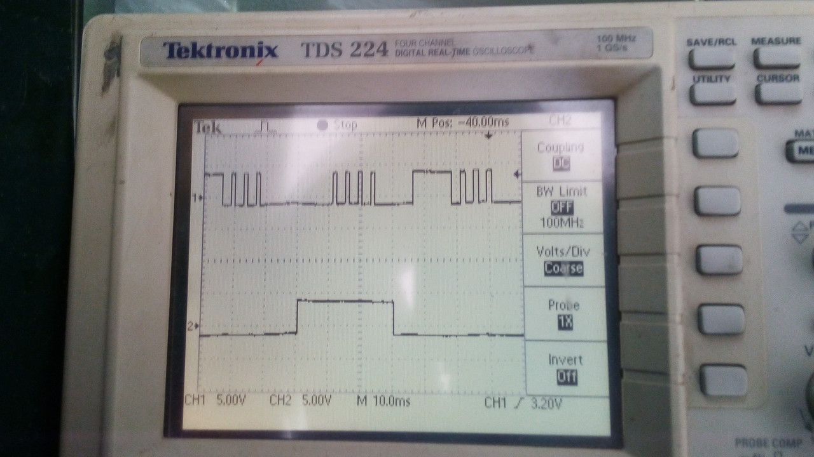
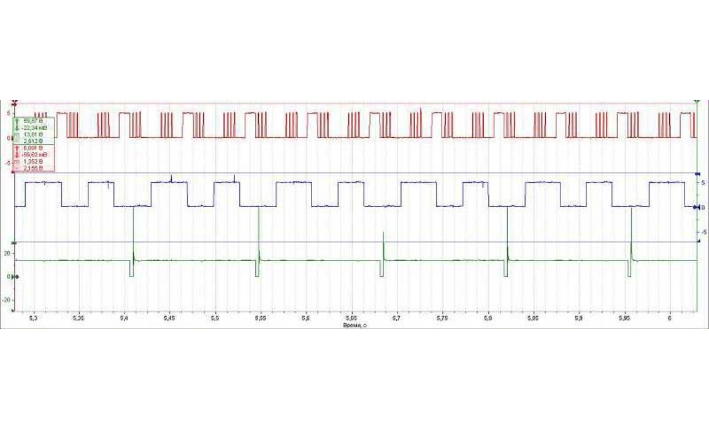
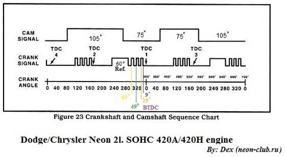

# Алгоритмы управления двигателем

Эта страница объясняет, что вычисляет прошивка и какие калибровочные таблицы в этом участвуют.
Имена подпрограмм относятся к исходнику, имена таблиц — к [справочнику калибровок](calibration_tables.md).
Разделы с пометкой *(по названиям)* следуют именам из исходного дизассемблера и ещё требуют сверки с
кодом.

## Положение двигателя и расписание событий

*Роли выведены из кода; подтвердить осциллографом на работающем моторе.*

- **Датчик коленвала -> TIC1 (PA2)** (`Isr_TIC1_CrankEvent`). Каждый фронт получает метку времени.
  Вместе с захватом 3 по второму фронту (PA0) прошивка измеряет ширину прорези и период и по ним
  находит опорные прорези. После синхронизации каждый фронт увеличивает `CrankEventCounter` ($0449) и
  вызывает один из четырёх обработчиков (`CrankPickupIntrAddressTable`) по фазе события:
  `CrankInterrupt_FallingEdge`, `..._HandleCamSensorRisingEdgeA/B` и `CrankInterrupt_CalculateFuel`.
- **Датчик распредвала -> PAI (PA7)** (`Isr_PAI_CamPhase`). Ловятся оба фронта: выбор фронта PAI
  переключается в каждом прерывании. Уровень сигнала коленвала в этот момент показывает, какая
  половина 720-градусного цикла идёт; по нему выставляется фаза в `CrankEventCounter` и флаги
  синхронизации (`SyncFlags74`, `SyncFlags75`).
- **Зажигание:** две катушки, холостая искра, управляются напрямую от **OC3 (PA5)** и **OC5 (PA3)**.
  `ScheduleIgnitionCoils` записывает время сравнения и действие вывода в TCTL1 (начало накопления,
  затем искра); `Interrupt_DwellTimerA/B` выставляют следующее действие.
- **Форсунки:** впрыск последовательный, но таймеры HC11 его **не** отсчитывают. `IncludeInjectorLatency`
  записывает итоговую длительность (в микросекундах, с задержкой форсунки) во внешнее устройство:
  `$0424` цилиндр 1, `$0428` цилиндр 2, `$042C` цилиндр 3, `$0430` цилиндр 4. `InjCylinderMask`
  выбирает цилиндры (бит 0 = цил. 4, бит 1 = цил. 2, бит 2 = цил. 1, бит 3 = цил. 3, порядок работы
  1-3-4-2), а запись `$04` в `$0410` передаёт импульс устройству.
- **Четыре обработчика событий коленвала** идут в фиксированной последовательности (фаза события = два младших бита `SyncFlags75`):

  | Фаза | Обработчик | Основные задачи |
  |---|---|---|
  | 0 | `CrankInterrupt_FallingEdge` | учёт периода и ширины прорези, отсечка по оборотам, проверка достоверности MAP, стабилизация холостого через УОЗ, передача импульсов форсункам |
  | 1 | `CrankInterrupt_HandleCamSensorRisingEdgeA` | планирование впрыска для следующих цилиндров |
  | 2 | `CrankInterrupt_HandleCamSensorRisingEdgeB` | планирование впрыска, индекс адаптивного отката, счётчики времени работы |
  | 3 | `CrankInterrupt_CalculateFuel` | обороты, замер MAP, окно детонации, принудительное управление катушками, рабочее топливо, откат по детонации по цилиндрам |

  (Названия «CamSensorRisingEdge» исторические: все четыре вызываются из прерывания коленвала.)
- **MAP** замеряется при фиксированном угле коленвала: фаза 3 запускает сканирование каналов АЦП 0-3 (`ADCTL = $10`).
- **Окно детонации:** фаза 3 задаёт `TOC4 = время фронта + 2 x время зуба x коэффициент / 256`, то есть
  фиксированную долю периода зуба после фронта; по истечении окна `Isr_TOC4_KnockSample` читает датчик детонации.
- **Сигналы датчиков** (осциллограммы на холостом ходу, около 880 об/мин: одна снята на машине автора
  проекта, вторая — опубликованная эталонная запись):

  
  *Машина автора проекта на холостом ходу: CH1 коленвал, CH2 распредвал, 10 мс/дел.*

  
  *Опубликованная эталонная запись: красный — коленвал, синий — распредвал, зелёный — опорный сигнал зажигания/форсунки.*

  
  *Диаграмма Chrysler для 2.0 SOHC (420A/420H) с пометками Dex (neon-club.ru).*

  - **Коленвал:** группа из четырёх импульсов каждые 180 градусов коленвала (одна группа на такт
    цилиндра, на холостом около 34 мс между группами). Внутри группы передние фронты идут примерно через
    3,8 мс, то есть около 20 градусов. В каждой второй группе первый импульс широкий (начинается
    примерно на 60 градусов раньше): так помечаются две половины оборота.
  - **Распредвал:** окна двух разных длин, примерно 0,83 и 1,17 от интервала между группами, в порядке
    длинное - короткое - короткое - длинное за 720 градусов, то есть четыре фронта за цикл.
  - **Совпадение с кодом:** IC1 видит четыре передних фронта каждой группы, это и есть четыре фазы
    событий, то есть четыре обработчика соответствуют четырём прорезям одного такта. Длинное время в
    низком уровне перед первым передним фронтом группы — это то, что ловит проверка ширины прорези в
    `Isr_TIC1_CrankEvent`. Замер MAP и окно детонации в фазе 3 (последняя прорезь, ближе всего к ВМТ)
    хорошо ложатся в эту картину. `Isr_PAI_CamPhase` читает уровень сигнала коленвала на каждом фронте
    распредвала: одни фронты попадают внутрь широкого импульса коленвала (уровень высокий), другие в
    промежуток (уровень низкий), и по этому определяется цилиндр.
  - **Углы** (сервисная книга Chrysler, «Crankshaft and Camshaft Sequence Chart», 2.0 SOHC 420A/420H):
    четыре прорези каждой группы стоят на **69, 49, 29 и 9 градусах до ВМТ**; широкое 60-градусное
    опорное окно идёт перед группами 1-го и 4-го цилиндров (каждые 360 градусов); окна распредвала
    105 / 75 / 75 / 105 градусов распредвала (210 / 150 / 150 / 210 градусов коленвала). Порядок работы
    1-3-4-2. Всё это совпадает с измерениями по осциллограммам выше.
  - Если фаза 0 — первая прорезь группы (фронт после длинной паузы), то фазы такие:
    **0 = 69, 1 = 49, 2 = 29, 3 = 9 градусов до ВМТ**. Фаза 3, в которой замеряется MAP и взводится
    окно детонации, — это прорезь 9 градусов до ВМТ.
  - **Требует проверки:** полярность сигналов на выводах HC11. Входной буфер может инвертировать сигнал
    датчика; тогда IC1 видит другой фронт каждой прорези, и углы фаз сдвигаются на ширину прорези.
    Для проверки нужно замерить сигнал на ногах процессора, а для этого вскрыть блок (плата залита
    мягким компаундом), поэтому пока это не сделано.

## Входные координаты

Большинство карт — 3D-таблицы, осями которых служат координаты 0-255 из передаточных кривых:

| Кривая | Вход -> выход | Где используется |
|---|---|---|
| `RPMSCL` | обороты -> координата столбца (`RPMRescaledfor3D`) | все карты «обороты x MAP» |
| `MAPHI` | MAP -> координата строки (`MAPRescaledfor3D`) | PRTTBL, HOTMRP, WOTMRP |
| `MAPWOT` | MAP -> координата строки для обогащения на полном дросселе | WOTENR |
| `MAPPTE` | MAP -> координата строки для обогащения на частичном дросселе | PTEADJ |
| `MAPHIP`, `MAPHII` | MAP -> координата строки, вне холостого / холостой | CLDLDP, CLDLDI |
| `MAPMOD` | MAP -> координата для карты базового (холодного) УОЗ | BASADV |
| `TIMESC` | время после пуска -> координата | CURV3D |

Поэтому точки карты задаются её передаточной кривой. В 5007033, например, Mopar изменил нижнюю часть
`RPMSCL`, и это сдвинуло первые столбцы всех карт «обороты x MAP».

## Топливо

### Где что считается

| Когда | Подпрограмма | Результат |
|---|---|---|
| Главный цикл, каждые 10,75 мс | `CalculateSumOfAllFuelModifiers_MM` | `SumOfFuelModifiers`: множители прогрева, послепусковой, барометра, температуры воздуха и лямбды |
| Главный цикл | `CalculatePartThrottleEnrichmentAndLatency_MM` | `ThrottleEnrichmentFactor` (частичный / полный дроссель) и `InjectorLatencyPW` |
| Главный цикл | `CalculatePartThrottleTransientFuel` | добавочный импульс «ускорительного насоса», обеднение на сбросе, поправка на шаги РХХ |
| Главный цикл | `CalculateInjectorPulsewidthForStarting_MM` | пусковая длительность и скорость её спада после пуска |
| Главный цикл | `HandleO2Processing_MM` | лямбда-регулятор и адаптивная память |
| Событие коленвала, фаза 3 (9° до ВМТ) | `CrankInterrupt_CalculateFuel` -> `CalculateInjectorPulsewidthForEngineRunning` -> `HandleTransitionFromStartToRun` -> `IncludeInjectorLatency` | итоговая длительность, записывается в регистры форсунок устройства ввода-вывода |

То есть медленные множители обновляются раз в 10,75 мс, а итоговая длительность считается раз на
каждый такт цилиндра по значению MAP, замеренному при том же угле коленвала.

### Рабочий режим

```
воздух   = (MAP - MAPMIN) x DFPART / 2
база     = воздух + воздух x PRTTBL(обороты, MAP) / 256
впрыск   = база x обогащение_по_дросселю x SumOfFuelModifiers  (+ обогащение при детонации)
         + импульс «ускорительного насоса»
впрыск   = max(впрыск, спадающий пусковой импульс)     пока стоит флаг пуска
итог     = впрыск x поправка_давления_топлива + InjectorLatencyPW x 4     (микросекунды)
```

- `PRTTBL` — основная топливная карта: поправка к базе, пропорциональной MAP, по смыслу похожая на
  таблицу наполнения (VE).
- **Обогащение по дросселю** (`CalculatePartThrottleEnrichmentAndLatency_MM`): карта частичного дросселя
  `PTEADJ` (обороты x `MAPPTE`) или полного `WOTENR` (обороты x `MAPWOT`), выбор по точке переключения
  `RPMMAP`. Коэффициент идёт к цели шагами (`PTENRP`, `PTENRN`, `PTENRD`), то есть обогащение
  нарастает и спадает плавно, а не скачком.
- **`SumOfFuelModifiers`** (`CalculateSumOfAllFuelModifiers_MM`) — произведение:
  - обогащения холодного мотора `CLDLDP` / `CLDLDI` (температура x нагрузка, вне холостого / холостой);
  - послепускового обогащения `CURV3D` (температура x время после пуска) с поправкой на перегрев после
    короткой остановки (`RUNTMP`, `RUNLMT`);
  - барометрической компенсации `BAROCP` и обогащения `BARENR x BARMAP x BARRPM`;
  - обогащения по температуре воздуха `AIRTMP x AIRMAP x AIRRPM`;
  - множителя лямбда-регулятора и адаптивной памяти.
- `KNNRCH` / `MAXKNR` добавляют топливо пропорционально суммарному откату по детонации.
- `TweakInjectorPW` позволяет диагностическому каналу подменить длительность впрыска (разрешается
  калибровочным байтом `$D03E`); в обычной работе неактивна.

### Пуск (`CalculateInjectorPulsewidthForStarting_MM`)

```
пуск = [STRTFL^2 x (1 - STFBAR - STFTMP) x EPPMUL + BATOFF x 4] x 4 мкс
```

`STRTFL` зависит от температуры охлаждающей жидкости (не ниже `STRLMT`), уменьшается с высотой
(`STFBAR`) и по мере прогрева (`STFTMP`, `STFTM2`). `EPPMUL` уменьшает топливо с числом импульсов
положения от начала прокрутки, а `STFLID` / `STFLOI` масштабируют его по оборотам при закрытом /
открытом дросселе. Дроссель, открытый больше чем на `UNLOAD` выше выученного минимума, отключает
пусковое топливо («продувка залитого мотора»). После пуска `HandleTransitionFromStartToRun` берёт
большее из рабочего импульса и пускового, спадающего со скоростью `SFDCAY`, а затем переходит только
на рабочее топливо.

### Переходные режимы (`CalculatePartThrottleTransientFuel`)

- **Открытие дросселя:** MAP и TPS сравниваются со сглаженными средними (постоянные времени `AETIME`,
  `THRTCN` от температуры). Рост выше `MAPTRG` / `POSTRG`, ограниченный `MAPMAX` / `THRMAX`, даёт
  добавочный импульс `приращение x AESLOP` или `приращение x POSSLP` (от температуры).
- **Закрытие дросселя:** падение даёт коэффициенты обеднения (`LOTTHR`, `NEGSL2`, пороги `LOTTRG`,
  `LOTRG2`, `DECTRG` с гистерезисом, постоянные времени `LMAPTC`, `LOTIME`, минимальные обороты
  `LOTRPM`) и после этого придерживает лямбда-регулятор на время `DCELTM`.
- **Шаги РХХ:** открытие или закрытие мотора холостого хода даёт небольшой добавочный или
  обедняющий импульс (`AISPL1`, `AISPL2`, `AISNLC`), чтобы смесь на холостом следовала за воздухом.
- **Отключение топлива на сбросе** (`DecideToUseDecelFuelCut`): закрытый дроссель, обороты между
  `DCLRPL` и `DCLRPH` относительно целевых оборотов холостого, температура выше `DCLMCT`, время работы
  больше `DCLMER`.

### Лямбда-регулирование и адаптивная память (`HandleO2Processing_MM`)

- Узкополосный датчик O2. Регулятор шагами подталкивает смесь в богатую или бедную сторону, пока датчик
  не переключится. Размер шага берётся из `PRIRMP` (первичная рампа) и `SECRMP` (вторичная) для
  **ячейки рампы**: 3 диапазона оборотов x 3 диапазона MAP (`DetermineRampCellFromRPMandMAP`), плюс
  ячейка холостого хода.
- Вторичная рампа заодно обучает **адаптивную память** (`AdaptiveMemory_*`): **ячейки 0-11** = шесть
  диапазонов MAP (`MP1`..`MP5`, гистерезис `DLTMAP`) x два диапазона оборотов (`R1`, гистерезис
  `DLTRPM`), плюс **ячейки холостого 12 и 13** для закрытого дросселя ниже целевых оборотов + `IDLOFS`
  (ячейка 13 — при втором состоянии нагрузки на холостом). Ячейки лежат в ОЗУ
  `AutoCalCell0`..`AutoCalCellEnd` и переживают тёплый перезапуск.
- `MAPLIM`, `MAPDEC`, `RPMLIM`, `PWMIN` задают, где ячейки не обновляются (разомкнутый контур на большой
  нагрузке); `O2LIMH`/`O2LIML` и `AMLIMH`/`AMLIML` ограничивают коррекцию.

## Зажигание (`CalculateSparkAdvance_MM`, главный цикл)

Путь выбирает бит 7 `BitFlags65` («дроссель открыт», тот же флаг выбирает ячейку холостого у лямбды).

**Вне холостого хода** (`LookupNormalAdvance`):

```
поправка   = BASADV(температура, MAPMOD) + BASMAP x BASRPM + BASMAP x BASCHG     (температура воздуха)
основа     = WOTMRP(обороты, MAPWOT)                        на полном дросселе (BitFlags65 бит 0)
           = HOTMRP(обороты, MAPHI) + ADOTFN(таймер после сброса газа)   на частичном
УОЗ        = основа + поправка + ADVNGM(разрежение относительно барометра)
           - адаптивный откат (ARRPM + ARMAP) x AdaptiveRetardIndex
           - откат по TPS (TPSRT1 / TPSRT2) - откат по скорости (RETSPD) - откат по скачку оборотов
           с ограничением MaxAdvanceLookup и минимальным углом
```

`MaxAdvanceLookup` — значение карты полного дросселя; на частичном дросселе при MAP не ниже точки
переключения `RPMMAP` оно уменьшается до значения частичного дросселя. Каждый шаг насыщается до знакового байта.

**Холостой ход** (`CalculateIdleAdvance`): `HOTMRP` + поправка по воздуху и MAP `IDLIAT x ILDMAP` +
поправки по температуре `IDLADV` / `IDLAD2` + подстройка от счётчика лямбда-регулятора (`ADO2C1`,
`ADO2C2`, пределы `ADO2CL`, `ADO2CH`).

**Стабилизация холостого через УОЗ** (`HandleSparkScatter`, в прерывании коленвала): обороты холостого
держатся в основном маленькими быстрыми изменениями угла (`SPKADD`/`SPKAD2` при оборотах ниже цели,
`SPKRET`/`SPKRT2` выше, от ошибки по оборотам); мотор РХХ делает медленную коррекцию.

**Детонация:**
- Датчик замеряется в конце окна, отсчитываемого OC4 (`Isr_TOC4_KnockSample`).
- `CalculateKnockRetard_MM` (главный цикл) считает детонацией превышение фонового среднего
  (`CalculateAverageKnockVolts_SM`) на `DLTKNK` (от оборотов), при MAP выше `KNKMAP` и оборотах выше
  `KNKRPM`; суммарный откат ограничен `RETMAX` (от MAP).
- Откат по каждому цилиндру обновляется в прерывании коленвала
  (`CALC_SPARK_RETARD_BASED_ON_KNOCK_VOLT`): скорость `RTRDRT`, восстановление `INCSRT`, предел `MAXRTD` (от MAP).
- Долговременный **адаптивный откат** (`ARMAP`, `ARRPM`) обучается при повторяющейся детонации;
  `ARMPIC = $FF` его отключает. Суммарный откат также обогащает смесь (`KNNRCH`, `MAXKNR`).

Значения УОЗ — знаковые байты с шагом 0,5 градуса (`raw / 2` = градусы до ВМТ).

## Холостой ход (`CalculateTargetIdleSpeed_MM`, `ControlAIS_MM`)

- Целевые обороты от температуры: `AISPN` (P/N или механика) и `AISCLD` (Drive, автомат), плюс добавки
  по времени и нагрузке (например, кривая сброса газа `TIMED2`).
- Шаги РХХ компенсируются в топливе (см. переходные режимы), а обороты холостого подстраиваются через УОЗ.

`ControlAIS_MM` хранит состояние РХХ в младшей тетраде `AISSubIndex` и на каждом проходе вызывает одну
подпрограмму состояния (`AISSubroutineTable`). Пока мотор не работает, он принудительно ставит
состояние 0 или 1 по оборотам (`BYTEc581`); неисправность датчика MAP включает состояние 15. В рабочих
состояниях `SelectAisStateA`/`SelectAisStateB` выбирают между открытым дросселем, закрытым дросселем и
круиз-контролем.

| Состояние | Подпрограмма | Когда | Что делает |
|---|---|---|---|
| 0 | `AisState0_EngineStopped` | Зажигание включено, мотор стоит | Держит `BYTEc580` + `CALPOS` (с барокомпенсацией), переходит в 1, когда обороты достигнут `BYTEc581` |
| 1 | `AisState1_Cranking` | Пуск | `AISTRT`(температура ОЖ) + `CALPOS` с барокомпенсацией; когда мотор РХХ дошёл до положения, передаёт управление рабочему состоянию |
| 4, 12 | `AisState4_ThrottleOpen`, `AisState12_ThrottleOpen` | Дроссель открыт | Положение по скорости (`MPHPOS`), оборотам (`RPMPOS`), 3D-таблице, холодному мотору (`CLDPOS`) и дросселю (`THRPOS`), берётся наибольшее |
| 5, 13 | `AisState5_ClosedThrottle`, `AisState13_ClosedThrottle` | Дроссель закрыт | Регулирование оборотов ХХ по обратной связи, компенсация кондиционера, решение об отсечке при сбросе газа |
| 6, 14 | `AisState6_SpeedControl`, `AisState14_SpeedControl` | Включён круиз (флаг ставит подпрограмма сервопривода круиза) | Удерживает положение для круиза |
| 15 | `AisState15_MapLimpIn` | Неисправен датчик MAP | Фиксированное положение, 32 шага |
| 2, 3, 7-11 | `AisState_Unused` | — | Не используются, возврат в состояние 0 |

Варианты 12-14 дополнительно применяют **записи шагов нагрузки** (`AisLoadStepRecords`, восемь записей
по 10 байт по адресу $37DE) через `AdjustAISPosition_A/B`. Каждая запись при выполнении своих условий
добавляет или снимает шаг из калибровочного байта и отмечает это в `AisLoadFlagsA`. Какой набор
состояний используется, зависит от того, совпадают ли `AisLoadFlagsA` и `AisLoadFlagsB`. [код] Какой
нагрузке соответствует каждая запись (кондиционер, вентилятор, ГУР …), пока не расшифровано.

## Ограничители (`ControlEngineCutout_MM`, `CalculateVariableRevLimit_MM`)

Топливо отключается на целые обороты коленвала:

- **Отсечка по оборотам:** `REVLMT5` / `REVLMT6` (обороты / 32).
- **Ограничитель скорости:** `SPDLMH` / `SPDLML`.
- **Аварийные ограничения**, когда неисправен сигнал MAP или TPS (`REVLMT` .. `REVLMT4`).
- **Отсечка по MAP («overboost»)** (`MPSHFT`, `MPSHFA`, `TRNTIM`), унаследована от турбо-кода.

## Экология

- **EGR** (`ExhGasRecirc_MM`): соленоид включается, когда обороты, MAP (с учётом барометра),
  температура и время после пуска лежат внутри окон `EGR21`..`EGR27`, и только если установлен бит
  конфигурации $B811.6.
- **Продувка адсорбера**: подпрограмма со скважностью по адресу $B290 (бит 5 `OutputDriverBits`) и
  `ControlPurgeSolenoid_MM` ($9C6A, бит 7 `OutputBits2`). B4CC `ControlPurgeSolenoid_MM` не вызывает,
  B559 вызывает (см. [code_bases.md](code_bases.md#b559-в-сравнении-с-b4cc)).
- **Монитор заднего датчика O2** (`VerifyOperationOfDownstreamO2Sensor_MM`), вызывается только в B559.
- **Мониторы OBD-II (спят).** В коде есть десять мониторов OBD-II (нагреватели O2, отклик O2,
  вторичный воздух, расход продувки EVAP, катализатор, расход EGR, богатая / бедная смесь, пропуски
  зажигания) и их планировщик `ObdMonitorScheduler` ($E9C5), но в B4CC планировщик никто
  не вызывает, так что там ни один из них не работает (в B559 вызывается). См. [diagnostics.md](diagnostics.md#мониторы-obd-ii).

## Другие выходы *(по названиям)*

- **Вентилятор радиатора** (`ControlFan_MM`, `FANTMP*`).
- **Муфта компрессора кондиционера** (`ControlAirConditioning_MM`), отключается на полном дросселе.
- **Реле ASD** (`ControlAsdRelay_MM`): питание бензонасоса, форсунок и катушек.
- **Обмотка возбуждения генератора** (`ControlAlternator`): напряжение заряда регулирует сам блок.
- **Блокировка гидротрансформатора** (`ControlPTU_MM`): только для автомата.
- **Сервопривод круиз-контроля** (`ControlCruiseServo0_MM`, `ControlCruiseServo1_MM`).

## Диагностика и связь

Протоколы DRB и ISO 9141, тесты исполнительных механизмов, лампы и мониторы OBD-II описаны в
[diagnostics.md](diagnostics.md), дескрипторы ошибок — в [fault_codes.md](fault_codes.md). Шина CCD
и вспомогательная микросхема, через которую она работает, описаны в [ccd_and_link.md](ccd_and_link.md).
